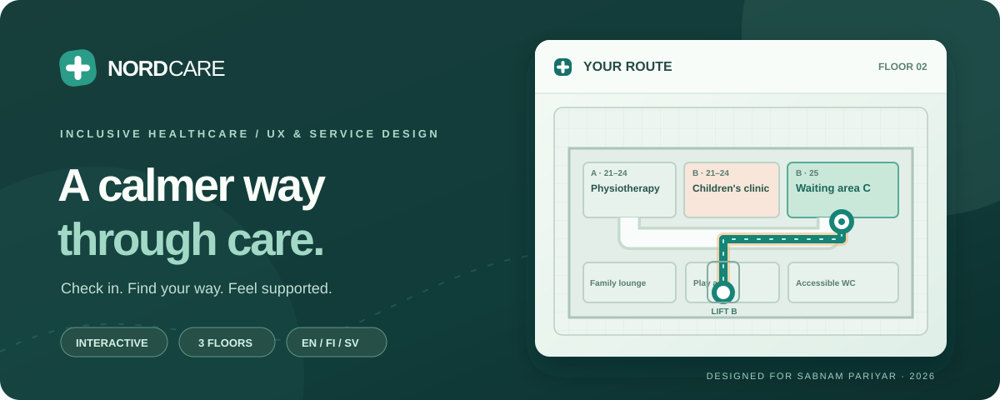
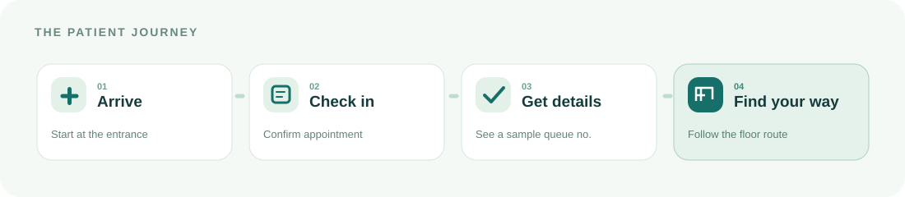
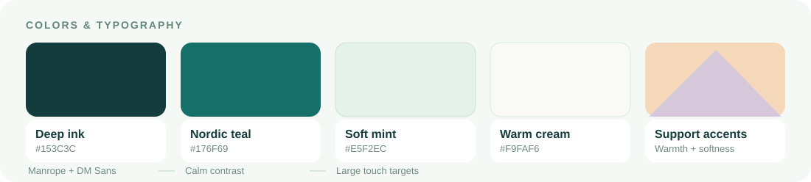

<p align="center">
  
</p>

<p align="center">
  <a href="https://sabnampariyar.github.io/NORDCARE-Hospital-Check-In-Wayfinding-UX-UI-Case-Study/">
    
  </a>
</p>

<p align="center">
  <strong>Hospital check-in · Indoor wayfinding · Inclusive service design</strong><br/>
  Interactive UX/UI case study · EN / FI / SV · Desktop and kiosk prototype
</p>

<p align="center">
  <a href="https://sabnampariyar.github.io/NORDCARE-Hospital-Check-In-Wayfinding-UX-UI-Case-Study/">Try the live demo</a>
  &nbsp;·&nbsp;
  <a href="#the-design-challenge">The challenge</a>
  &nbsp;·&nbsp;
  <a href="#what-the-prototype-includes">Explore features</a>
  &nbsp;·&nbsp;
  <a href="#research-and-design-rationale">Research</a>
  &nbsp;·&nbsp;
  <a href="#prototype-and-implementation">Implementation</a>
</p>

---

## A calmer way through care

NORDCARE explores a more reassuring hospital arrival experience—from walking into the building to confirming a fictional appointment and finding the right waiting area.

The concept brings **self-service check-in, family-friendly guidance and indoor navigation** together in one accessible experience. It is a complete *interactive prototype*, not a collection of static screens.

| **Designed for patients** | **Designed for families** | **Designed for clarity** |
| :--- | :--- | :--- |
| Simple language and fewer decisions at each step | A dedicated guardian-accompanied child journey | A connected, three-floor hospital map |
| Assisted check-in options and staff fallback | Calm visual cues and pediatric destinations | Clear route segments, floor changes and print option |
| Large-text and contrast controls | Appointment and queue details without real records | Step-free routes through lifts where selected |

## The design challenge

A hospital visit can become stressful before care even begins. Entrances, check-in machines, reception desks, queue numbers, department names and corridors often feel like separate systems.

> **How might we make hospital arrival feel like one guided service—clear, calm and inclusive from entrance to destination?**

<p align="center">
  
</p>

### Two journeys, one service

| Adult patient | Parent or guardian with a child |
| :--- | :--- |
| Choose language and a simulated check-in method | Choose a dedicated, child-friendly experience |
| Simulate Kela card or QR check-in | Follow a guardian-accompanied simulated check-in |
| Confirm a fictional appointment | Confirm a fictional pediatric appointment |
| Receive an example queue number | Receive an example queue number |
| Navigate to waiting area A | Navigate to waiting area C |

Both journeys retain a visible option to **get help from reception staff**.

## What the prototype includes

| Area | Experience |
| :--- | :--- |
| **01 — Patient kiosk** | Functional step-by-step check-in with local simulated state and back/next interaction. |
| **02 — Inclusive controls** | Finnish, Swedish and English; larger text; contrast setting; reduced-motion support; step-free routing. |
| **03 — Family-friendly UI** | A calmer companion flow for visits with children, with reassuring wording and simple choices. |
| **04 — Indoor navigation** | Three selectable floors, wings, corridors, room labels, lifts, stairs and waiting areas; connected SVG route geometry. |
| **05 — Visual system** | Soft cream surfaces, deep Nordic teal, mint highlights, readable typography and generous touch targets. |
| **06 — Ambient motion** | Restrained Three.js fragment shader and SVG animation, with CSS/SVG fallback when WebGL is unavailable. |
| **07 — Service thinking** | Service blueprint covering patient-facing, staff-facing, backstage and support layers. |
| **08 — Research trail** | International desk research informing the design questions and prototype decisions. |

### The three-floor wayfinding concept

The map is designed as a *building*, not a decorative dotted line:

- **Floor 1 — Entrance and diagnostics:** main arrival, reception, service areas and diagnostic destinations.
- **Floor 2 — Family clinics:** pediatric appointments and family waiting areas.
- **Floor 3 — Treatment and therapy:** additional clinical destinations.
- **Connected vertical circulation:** lifts and stairs occupy aligned locations across floors.
- **Graph-based routing:** the displayed highlight follows the same connected walkway model used to draw the corridors. Accessible routes can favor lifts, and relevant floor legs can be enlarged or printed.

**Important map accuracy note:** This is a fictional hospital with invented rooms, departments, floor plans and routes. It is **not to scale** and is **not safe for navigation inside a real hospital**. Deployment would require approved CAD/BIM or surveyed plans, validated room IDs, permitted corridors, live closures, accessible-route constraints, signage matching and on-site staff/user validation. The shader does not determine route geometry.

## A small, consistent design language

<p align="center">
  
</p>

**Manrope + DM Sans** establish a friendly but readable information hierarchy. Nordic teal connects primary actions and navigational routes, while mint creates calm selected states. Generous spacing, clear focus and touch targets reduce the visual demand of a potentially stressful arrival.

Accessibility is a **functional design requirement**, not just a color choice.

## Research and design rationale

The concept draws on published hospital guidance and wayfinding literature across **Finland, the UK, the United States, Singapore and Australia**. This is **desk research**; it does not claim original interviews, hospital approval, usability outcomes or clinical validation.

<details>
<summary><strong>Explore the research references</strong></summary>

1. [HUS patient arrival and self-registration](https://www.hus.fi/en/patient/patient-guide/welcome-treatment-hus) — self-registration and staff fallback.
2. [HUS Jorvi Hospital arrival guidance](https://www.hus.fi/en/patient/hospitals-and-other-units/jorvi-hospital/arriving-jorvi-hospital) — getting to the appropriate waiting area.
3. [Pohde / Oulu University Hospital emergency guidance](https://pohde.fi/palvelut/paivystys/?area=oulu) — local automated registration context, distinct from planned outpatient appointments.
4. [East Kent NHS patient appointments](https://www.ekhuft.nhs.uk/information-for-patients/your-appointment/) — check-in and destination guidance.
5. [Cleveland Clinic appointment information](https://my.clevelandclinic.org/patients/information/appointments-checklist) — mobile/manual options and human assistance.
6. [Singapore HealthHub pre-registration](https://support.healthhub.sg/hc/en-us/articles/52607597773849-How-do-I-pre-register-and-obtain-a-queue-number-for-my-appointment-using-HealthHub-app) — preregistration and queue numbers.
7. [NSW Health: Wayfinding for Healthcare Facilities (PDF)](https://www.health.nsw.gov.au/Hospitals/Publications/wayfinding-for-healthcare-facilities.pdf) — environmental wayfinding considerations.

</details>

### Privacy, Kela card and guardian boundaries

- A **Kela card is not an official identity document**. Participating services may use it for check-in, but the workflow must not equate card scanning with proof of identity. See [Kela's guidance](https://www.kela.fi/kela-card).
- A child's card **does not automatically authorize** an accompanying adult to act for that child. Real services need verified guardian/consent handling and staff-managed exceptions. See [Suomi.fi guidance](https://www.suomi.fi/instructions-and-support/e-authorizations/acting-on-behalf-of-a-person/acting-on-behalf-of-an-underaged-child).
- **No real patient data:** the prototype has no patient-record integration, hospital backend or real registration. Every identity, appointment and queue number is fabricated for demonstration; nothing is transmitted or stored by the prototype.

## Prototype and implementation

The demonstration is a lightweight, buildless static project under `dist/`:

```text
dist/
  index.html       Case-study layout and sourced research
  styles.css       Responsive layout, design tokens and controls
  app.js           Interactive adult and child check-in flows
  shader.js        Three.js ambient shader and fallback
  wayfinding.js    Three-floor navigation, routes and print views
tests/
  wayfinding.test.cjs  Walkway connectivity and route invariants
```

**Run locally:** open `dist/index.html`, or serve the `dist/` directory with any static web server. The kiosk interaction works without Three.js or an active network connection. Optional fonts and visual effects load when available.

**If this became a hospital service:** the next steps would include patient and staff research, usability testing, accessibility audits, localization review, information security/privacy work, device ergonomics, clinical governance, and rigorously validated site-specific floor plans and system integration.

---

<p align="center">
  <strong>NORDCARE · A calmer way through care.</strong><br/>
  Independent UX/UI and service-design portfolio concept for <strong>Sabnam Pariyar</strong> · 2026<br/>
  <em>Not affiliated with any hospital or healthcare authority. No real patient registration.</em>
</p>

<p align="center">
  <a href="https://sabnampariyar.github.io/NORDCARE-Hospital-Check-In-Wayfinding-UX-UI-Case-Study/"><strong>Explore the live prototype →</strong></a>
</p>
